

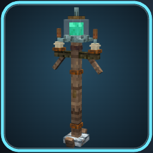

# ⚡ Automação — Vintage Story

**Energia sem fio, máquinas velhas e enferrujadas fazendo o trabalho chato — e um Manual que ensina tudo.**

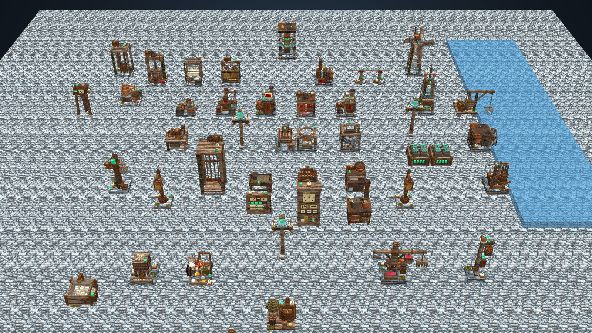

Uma base de exemplo com todas as peças da Automação — cada quadrado colorido é o alcance de um Poste de Energia.

---

## O que é

A **Automação** traz energia pro Vintage Story do jeito que o jogo merece: nada de cabo, nada de cara de ficção científica.
São máquinas velhas de ferro enferrujado, madeira gasta e cobre esverdeado, com musgo nos cantos — cada uma com motor,
engrenagens que engatam de verdade, uma lampadinha azul que acende quando tem energia e um **bauzinho** de 16 espaços.

- **5 fontes de energia**: água, chuva/raio, vento, sol e lenha.
- **Baterias** guardam a sobra pra noite e pro inverno.
- **Postes de Energia** levam a energia **sem fio, por alcance** (8 blocos pra cada lado). Clicou no poste, vê o alcance e o caminho da energia.
- **36 máquinas** fazem o trabalho chato: moer, peneirar, pescar, serrar, fazer carvão, defumar, colher, tirar mel, cuidar de cogumelo, levar as coisas pros baús, encher cocho, consertar ferramenta, acender tocha, fazer cerâmica, fundir, forjar, prensar fruta, destilar, cozinhar, curtir couro, tecer, chocar ovo, cavar pedreira, achar minério, gelar comida, esquentar a casa, iluminar, irrigar, abrir portão, eletrificar cerca, elevador, calendário com previsão da **tempestade temporal**, estabilizador temporal e a **Sentinela**.
- **Começo à mão**: 3 peças movidas no braço (segurar o clique), sem energia, pra chegar no cobre e na primeira rede sem pular etapa.
- **Pedestal do Raio**: o raio da tempestade transforma Engrenagem Enferrujada em **Engrenagem Temporal**.
- **O Manual**: você ganha na primeira vez que entra no mundo (novo ou já criado) e também dá pra fazer. Tem o guia de cada peça com a receita e um **guia completo dos primeiros 100 dias**: inverno, comida, metalurgia, animais, perigos, tempestade temporal e dicas de veterano.

## Como a energia funciona

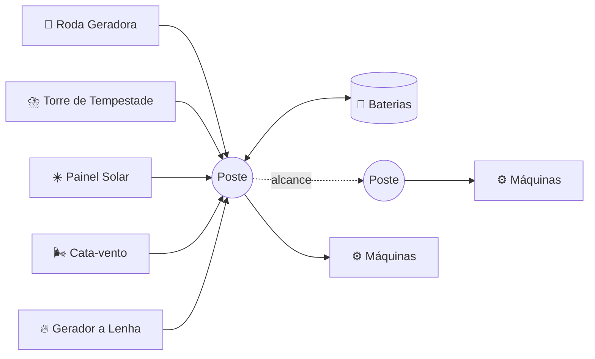

1. Toda **fonte**, **bateria** e **máquina** dentro do alcance de um **Poste de Energia** (8 blocos pra cada lado, 8 pra cima/baixo) entra na rede dele, sozinha.
2. Postes que alcançam um ao outro viram **uma rede só** — dá pra levar energia longe.
3. A cada segundo a rede soma o que as fontes geram e o que as máquinas pedem. Sobrou? Vai pras baterias. Faltou? As baterias cobrem. Acabou tudo? As máquinas param e a lampadinha apaga.
4. No mundo a energia é **invisível**. Na janela do poste tem **Mostrar alcance** e **Ver conexões** (desenha o caminho por alguns segundos).
5. Toda peça **gira com a chave inglesa** do jogo e mostra o estado ao olhar pra ela.

## 🆕 Novidades

- **1.3.0** — **Pedestal do Raio**: encaixe uma Engrenagem Enferrujada e, na tempestade, o raio de verdade do jogo cai nele e ela vira **Engrenagem Temporal**. Luz, Poste, Torre de Tempestade, Painel Solar, Estabilizador e Calendário voltaram a pedir **vidro** (estavam pedindo lenha por engano).
- **1.2.0** — Começo à mão sem tábua (tábua precisa de serra de metal): agora é lenha, graveto, capim seco, sílex e pedra solta. **Modo automático**: Shift + clique com a mão vazia e a peça trabalha sozinha enquanto você está por perto.
- **1.1.0** — **Começo à mão**: Peneira de Balanço, Torno de Vara (faz a **Engrenagem de Madeira**, que serve nas fontes de energia) e Gerador de Manivela. Estufa de Cogumelos cultiva até 2 espécies por bloco, sem precisar de tronco.
- **1.0.1** — Janela das máquinas refeita: nada de texto por cima dos botões, chavinhas nas opções e o botão **Como funciona?** que abre o Manual no capítulo da peça.

## 🪵 Começo à mão

Sem energia: segure o clique direito pra usar (ou **Shift + clique com a mão vazia** pro modo automático).

| | Peça | O que faz | Energia/s |
|---|---|---|---|
| 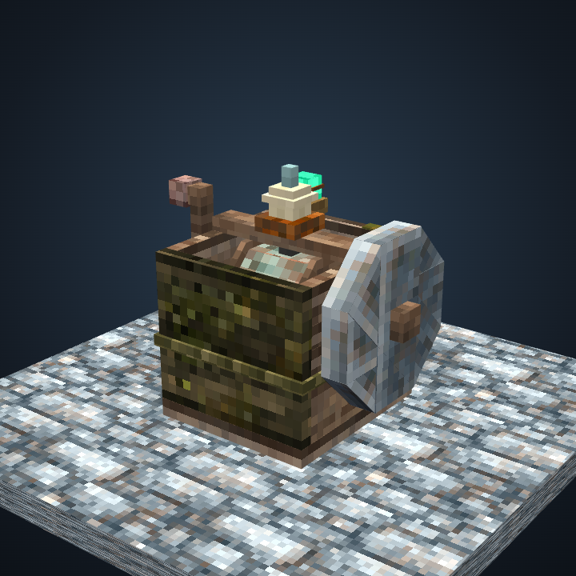 | **Gerador de Manivela** | Caixote de tábua com um carretel enrolado de fio de cobre girando entre duas pedras-ímã. SEGURE o clique direito pra girar a manivela: enquanto gira, sai um pouquinho de energia (uns 2 por segundo) pra rede. | gera 2 enquanto gira |
| 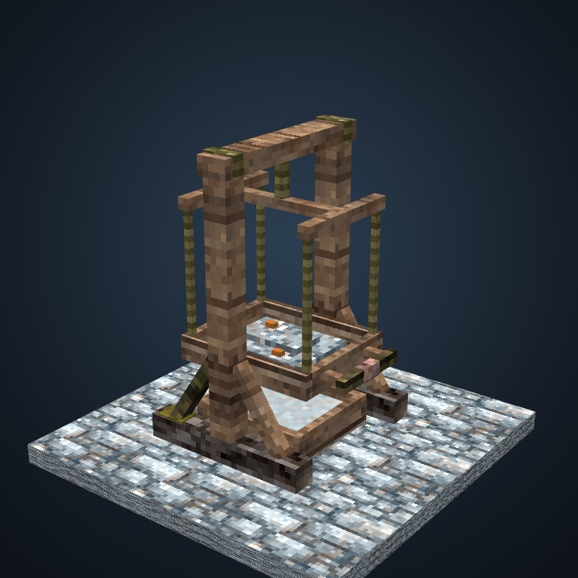 | **Peneira de Balanço** | Peneira de moldura de tábua com fundo de cesto trançado, pendurada por 4 cordas num cavalete de madeira. | à mão (segure o clique) |
| 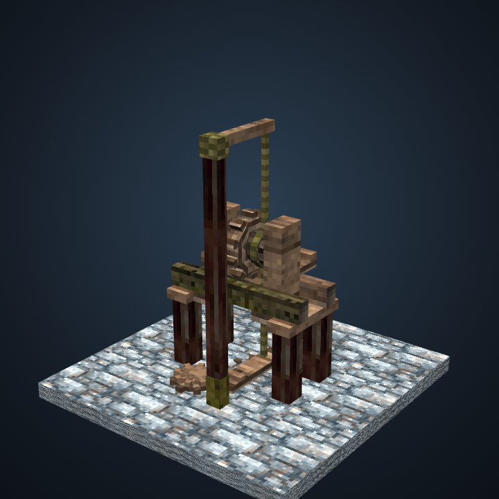 | **Torno de Vara** | Torno de pedal à moda antiga: a corda dá voltas na peça, vai até a vara-mola em cima e até o pedal embaixo. SEGURE o clique direito pra pedalar: a peça gira pra lá e pra cá e o formão de sílex vai entalhando. | à mão (segure o clique) |
| 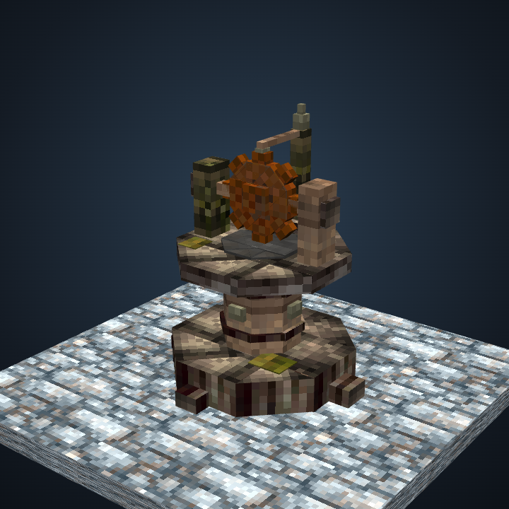 | **Pedestal do Raio** | Pedestal de madeira com uma vara de ponta de sílex que puxa raio. Clique direito com uma Engrenagem Enferrujada pra encaixar ela no berço (clique de novo com a mão vazia pra tirar). | não usa (o raio faz tudo) |

### ⛈️ Pedestal do Raio

Encaixe uma **Engrenagem Enferrujada** no berço (clique direito com ela na mão) e deixe o pedestal **a céu aberto**.
Quando tem tempestade, ele puxa pra ele os raios de verdade que caem até **64 blocos** dali: o raio desce pela vara de ponta de sílex,
passa pela lasca que encosta na engrenagem e ela vira **Engrenagem Temporal**. Uma por raio. Clique com a mão vazia pra pegar.
Cuidado: o raio machuca quem estiver perto!

## ⚡ Fontes de energia

| | Peça | O que faz | Energia/s |
|---|---|---|---|
| 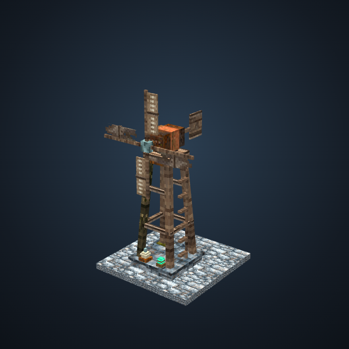 | **Cata-vento Gerador** | Fonte de energia do vento — pra quem não mora perto de rio. Torre de madeira com hélice de lona velha e dínamo de cobre no cubo; o leme vira ela pro vento sozinho. | gera até 10 |
| 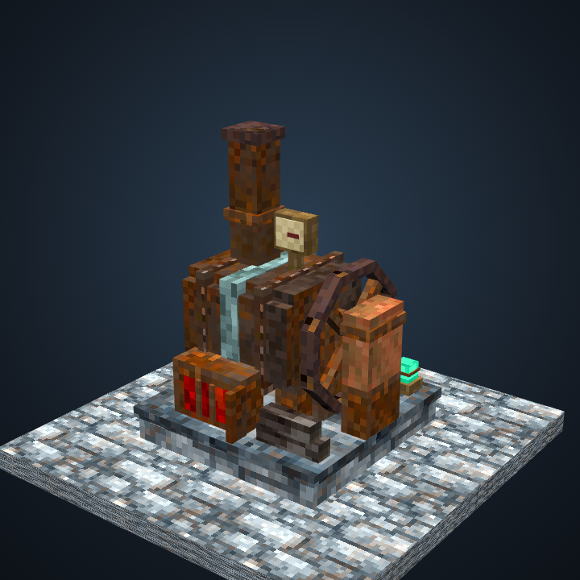 | **Gerador a Lenha** | Energia de emergência, em qualquer lugar: caldeirinha a vapor. Bota lenha, tábua ou carvão na fornalha (carvão dura mais), a água ferve, o vapor gira o volante e o volante puxa o dínamo. | gera 3 a 8 |
| 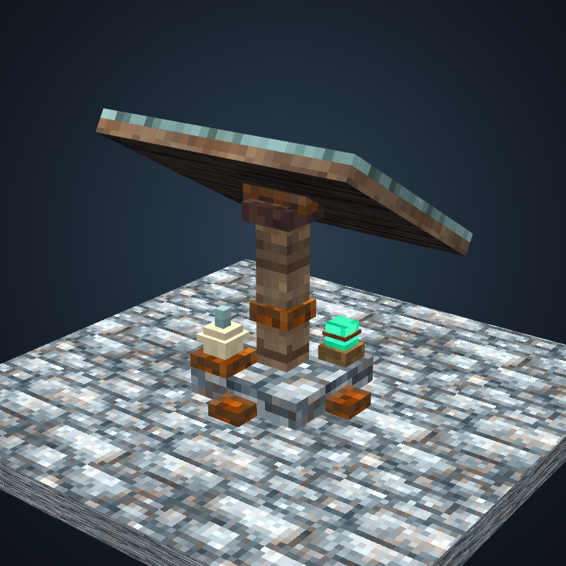 | **Painel Solar** | Placas de vidro escuro com moldura de cobre velho num cavalete de madeira: viram devagar seguindo o sol. Gera de dia — mais no verão e ao meio-dia, pouco nublado, nada à noite ou com chuva. | gera até ~7 de dia |
| 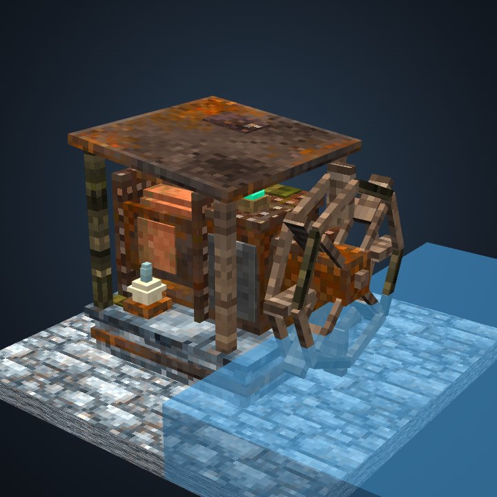 | **Roda Geradora** | Fonte de energia da água. Fica na beira do rio: a correnteza gira a roda, a caixa de engrenagens acelera e o dínamo de cobre gera energia, que sai pelo borne da frente. | gera 2 a 12 |
| 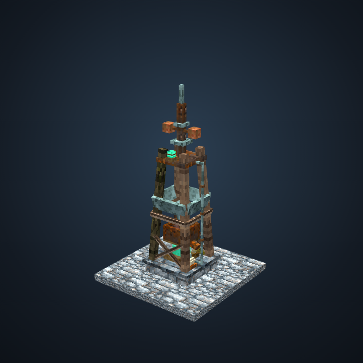 | **Torre de Tempestade** | Fonte de energia do tempo. Tem 2 andares de altura. Quando chove, a água cai no funil de cobre e gira a turbininha (energia pouca e contínua). | gera 3 a 12 na chuva + raios |

## 🔋 Baterias e postes

| | Peça | O que faz | Energia/s |
|---|---|---|---|
| 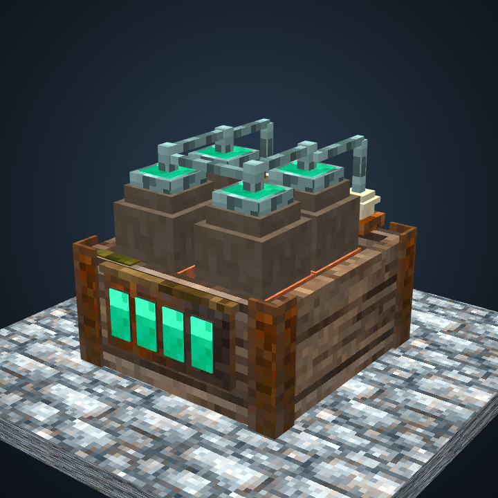 | **Bateria** | Guarda energia pra quando a fonte para (noite sem chuva, rio congelado...). Caixote com 4 jarros de barro ligados em série; o marcador da frente mostra a carga em 4 barrinhas e o clique direito mostra o número. | guarda 20 000 · entrega até 40/s |
| 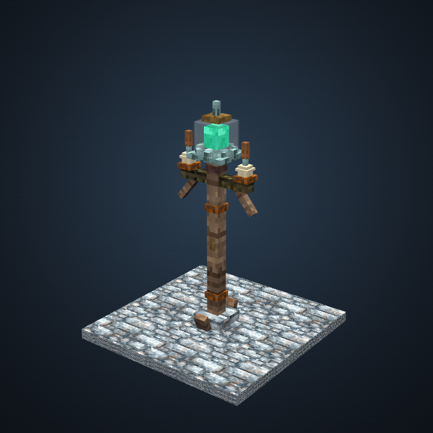 | **Poste de Energia** | SEM FIO: o poste manda a energia por alcance. Tudo que estiver dentro do quadrado dele (8 blocos pra cada lado) se liga sozinho — fontes, baterias e máquinas. | alcance 8 blocos pra cada lado |

## ⚙️ Máquinas

| | Peça | O que faz | Energia/s |
|---|---|---|---|
| 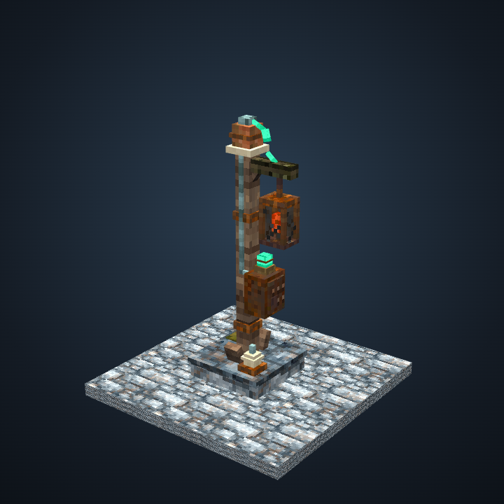 | **Acendedor de Lampiões** | Versão elétrica do Lamparineiro. | 1 (só de noite) |
| 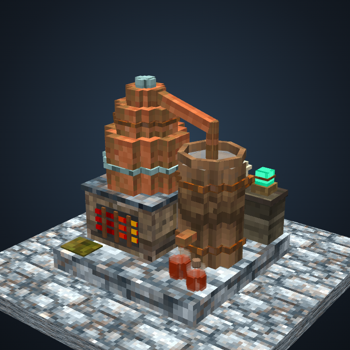 | **Alambique** | Destila sozinho: bota vinho, cidra, cerveja ou fermentado na panela de cobre e a fornalha elétrica esquenta (o soprador de trás atiça). | 3 |
| 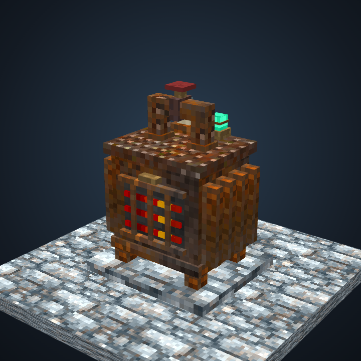 | **Aquecedor** | Estufa de ferro fundido com resistências em brasa atrás da grade e aletas de radiador: mantém a casa quente num raio (8 blocos) sem fogueira — dentro do alcance a temperatura do corpo não cai no inverno. | 3 (no frio) |
| 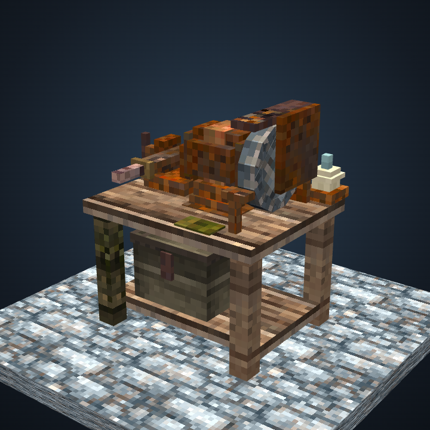 | **Bancada Elétrica** | Versão elétrica do Ferreiro. | 3 |
| 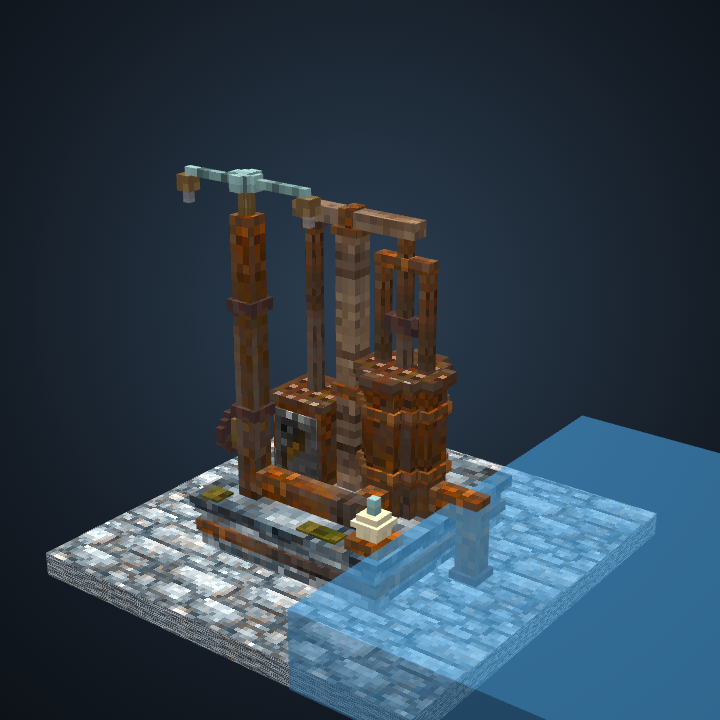 | **Bomba d'Água e Irrigador** | Bomba de balancim ("cavalo de pau") na beira da água: o motor gira a caixa de engrenagens, que balança o balancim; ele puxa o pistão do cilindro, que tira água do rio pelo cano. | 1 |
| 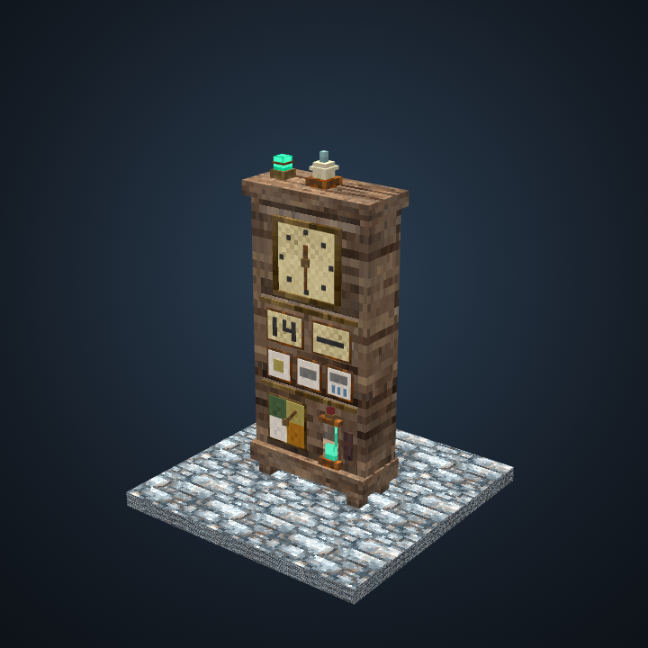 | **Calendário Elétrico** | Armário de relógio velho que sabe tudo do tempo. Em cima: o relógio com a hora do jogo. Embaixo: o dia e o mês. A fileira do meio é a previsão — hoje / amanhã / depois de amanhã (sol, nublado ou chuva; neve no inverno). | 1 |
| 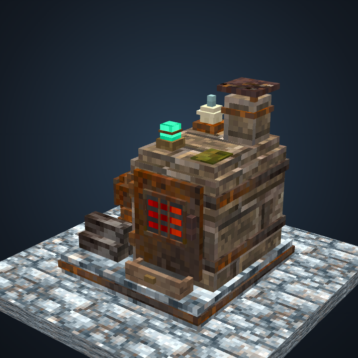 | **Carvoeira Elétrica** | Versão elétrica do Carvoeiro: bota lenha (ou toras) e ela vira carvão sozinha, sem montar poço de carvão. | 3 |
| 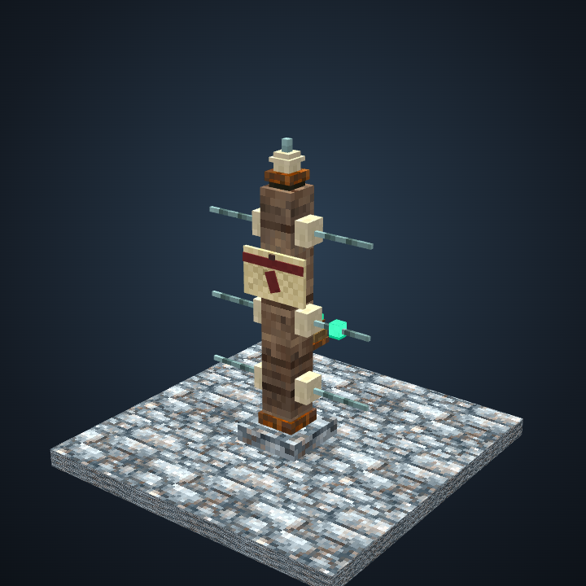 | **Cerca Elétrica** | Mourão com isoladores de barro e 3 fios de arame de cobre — coloque um do lado do outro e os fios emendam sozinhos. | 1 |
| 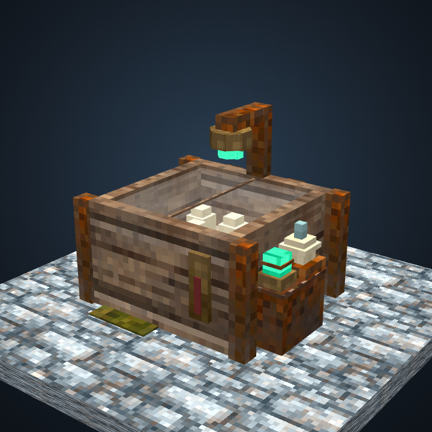 | **Chocadeira** | Caixa de madeira com tampa de vidro e lâmpada de calor: põe os ovos (galados) na palha e ela mantém a temperatura certa, igual a galinha chocando. O pintinho sai sozinho e fica do lado. | 1 |
| 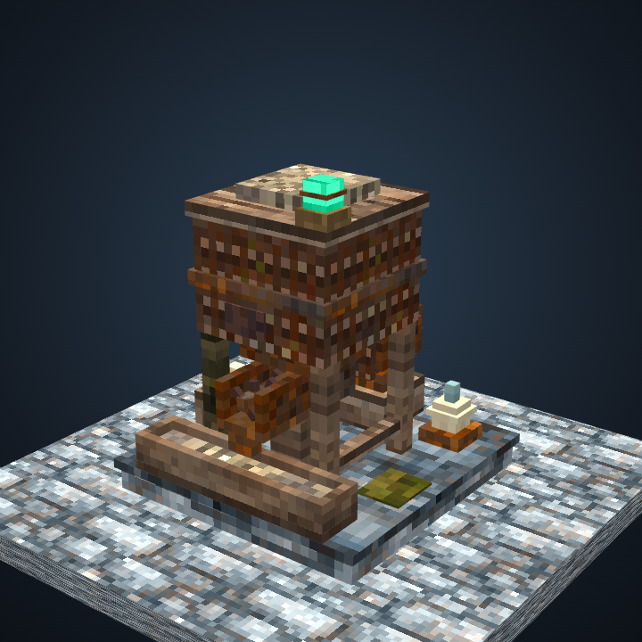 | **Cocho Automático** | Versão elétrica do Pastor. Bote ração (grão, feno) no silo: a rosca vai soltando no cocho e enche os cochos dos bichos na área sem passar do limite. | 1 |
| 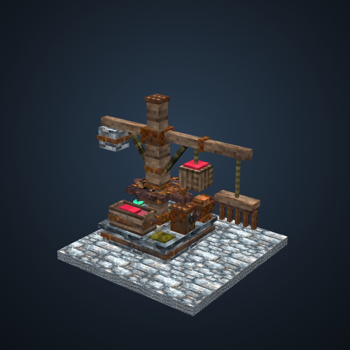 | **Colheitadeira** | Versão elétrica do Colhedor. Coloca no meio da horta: o motor gira o pinhão, que gira a coroa presa na luva do poste, e o braço dá a volta devagar. | 1 |
| 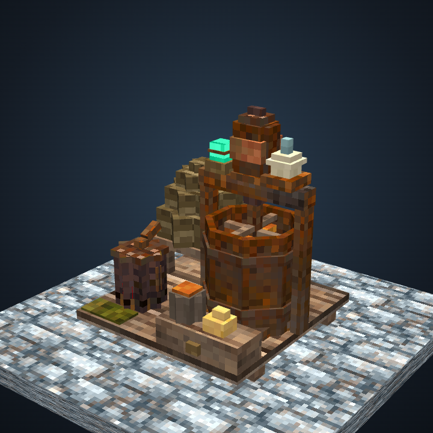 | **Colmeia Elétrica** | Versão elétrica do Apicultor: o fumegador elétrico acalma as abelhas, a máquina tira os favos das colmeias e skeps da área (sem picada!) e a centrífuga redonda gira os quadros — o motor em pé em cima da ponte toca o eixo direto — separando o mel da cera. | 1 |
| 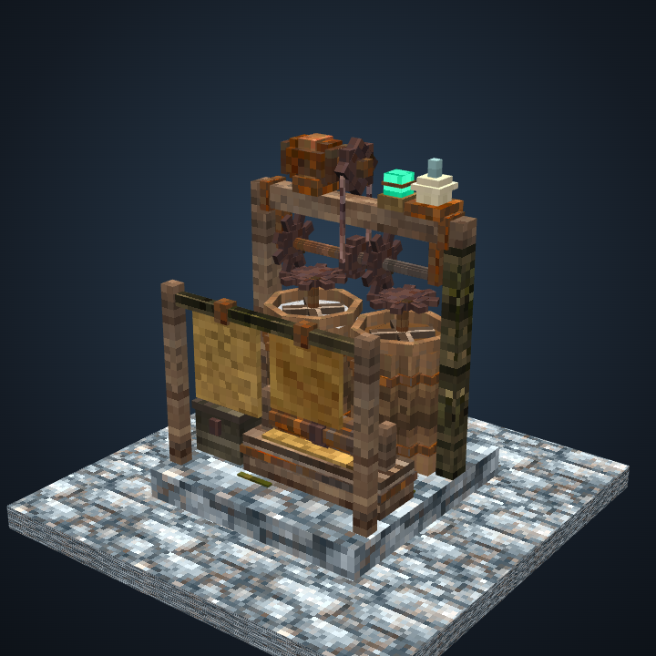 | **Curtume Automático** | Faz todo o trabalho chato do couro sozinho: bota a pele crua no bauzinho e ela passa pelo barril de cal (solta o pelo), pelo rolo raspador (raspa) e pelo barril de tanino (curte), até sair couro pronto. | 1 |
| 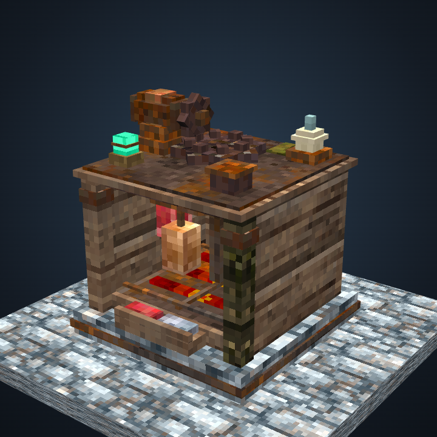 | **Defumador Elétrico** | Versão elétrica do Defumador: pendura carne e peixe nos ganchos do carrossel redondo, a grelha elétrica esquenta e solta a fumaça, e o carrossel vai girando pra defumar tudo por igual — em cima do teto o pinhão do motor toca a engrenagem de coroa do eixo. | 3 |
| 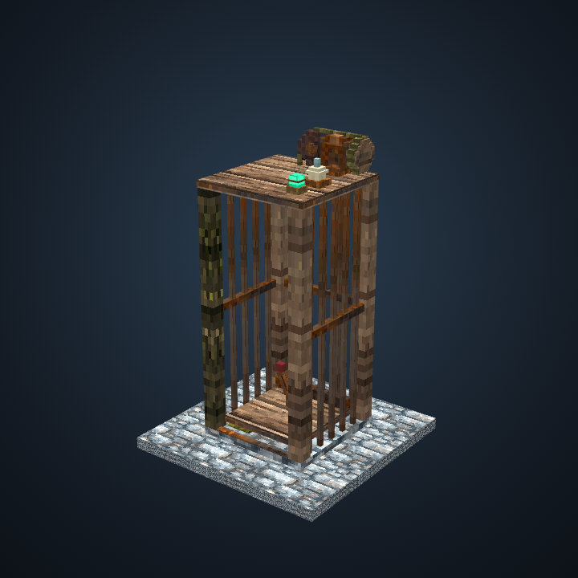 | **Elevador** | Substitui o mod Dumbwaiter (o dele vai ser removido, então tire os baús das estações antigas antes, porque elas somem). | 8 por viagem |
| 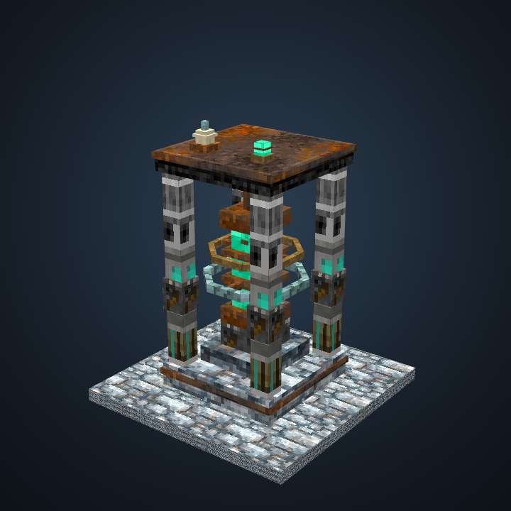 | **Estabilizador Temporal** | A máquina grande: núcleo temporal azul preso entre dois cálices de ferro, com anéis girando em volta e engrenagens nas colunas. | 8 |
| 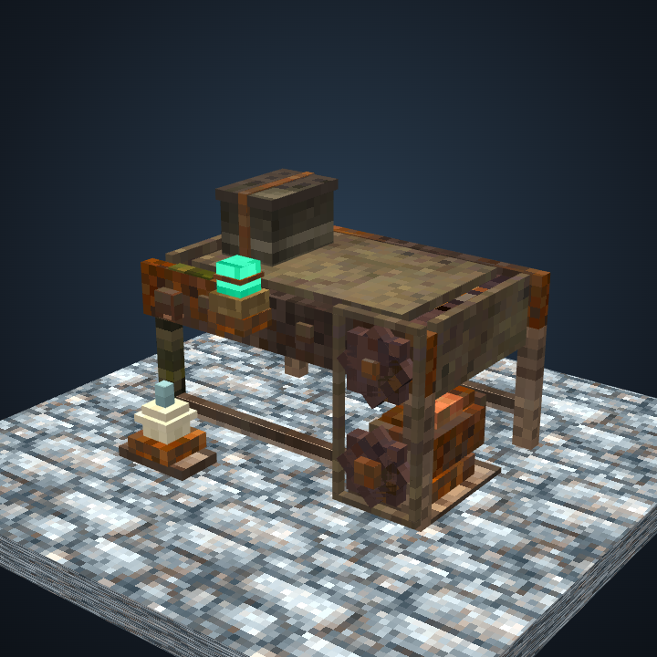 | **Esteira Transportadora** | Versão elétrica do Tropeiro. Esteira de lona velha sobre rolos, entre trilhos de ferro: leva sozinha o que as máquinas produzem (bauzinho de cada uma) pros baús do armazém — respeitando o que cada máquina precisa de insumo. | 1 |
| 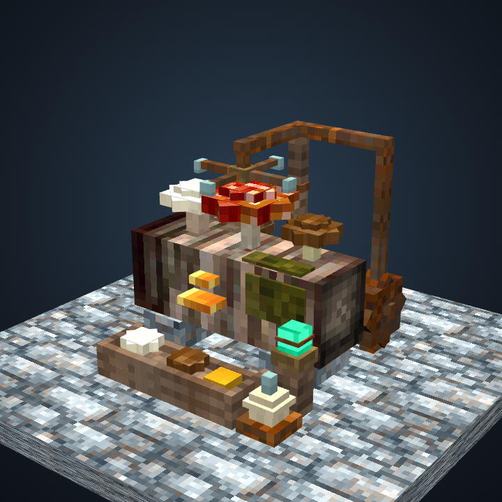 | **Estufa de Cogumelos** | Cultiva cogumelos sozinha, sem tronco: coloque cogumelos no bauzinho e escolha até 2 espécies por estufa (quer mais espécies? faça mais estufas). | 1 |
| 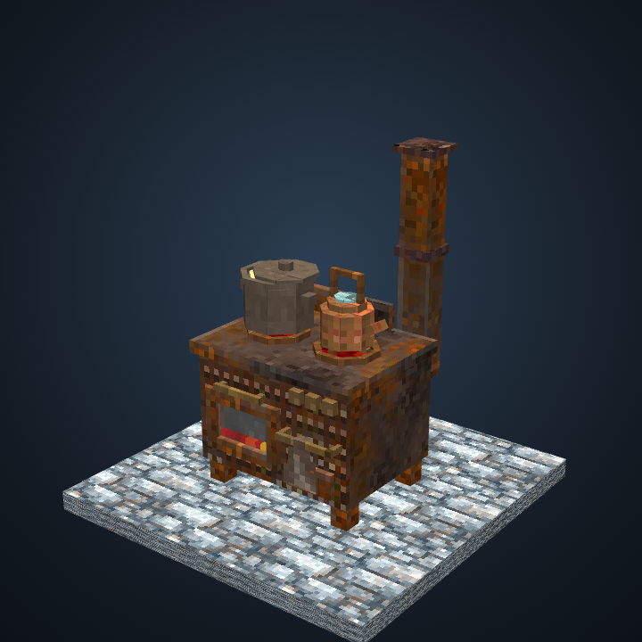 | **Fogão Elétrico** | Fogão de ferro fundido de 2 bocas: a panela de barro (cozinha a receita da panela do jogo sozinho, no ponto, e a tampa treme quando ferve) e a chaleira de cobre (ferve água). Embaixo, o forninho com janelinha assa pão e torta. | 3 |
| 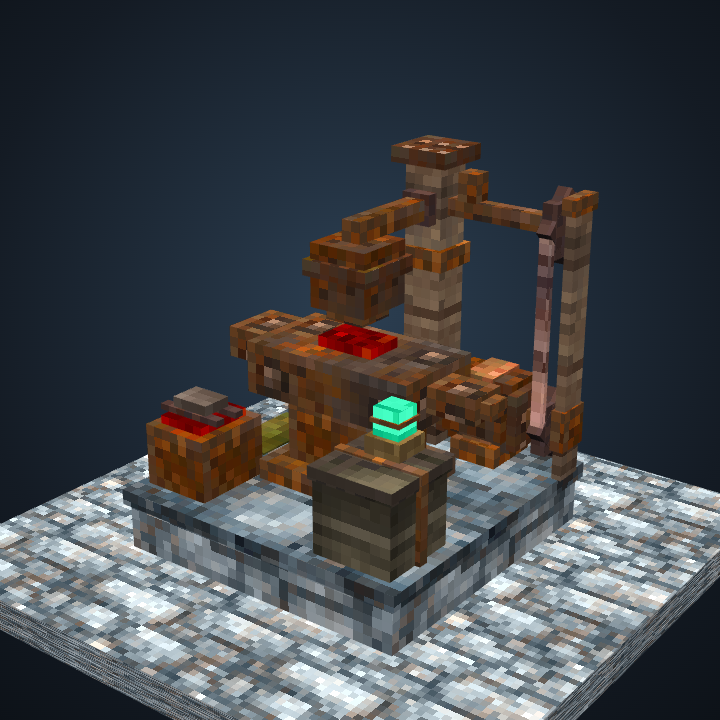 | **Forja Automática** | Forja e bigorna automáticas: o braseiro elétrico esquenta o lingote ou a placa e o martinete (martelo movido a motor) bate sozinho na bigorna, fazendo a receita simples que você escolher no clique direito — placa, pregos, cabeças de ferramenta, rebites. | 8 |
| 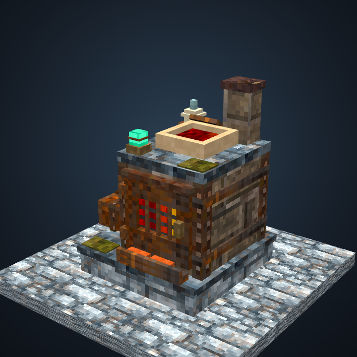 | **Fornalha Elétrica** | Fornalha de barro com resistências elétricas: faz o que a fogueira/forno faz, sem lenha nem carvão. | 8 |
| 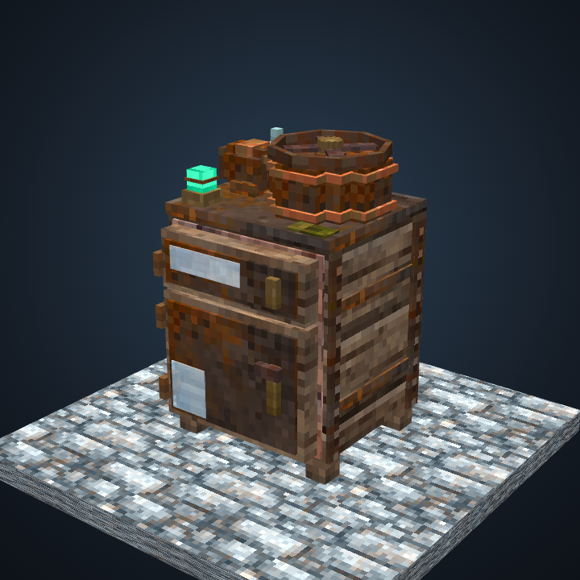 | **Geladeira** | Geladeira antiga "de motor em cima": armário de tábua forrado de chapa, com 2 portas grossas vedadas com couro (congelador em cima, geladeira embaixo), serpentina de cobre atrás e a caixa redonda do compressor em cima, com a ventoinha girando. | 3 |
| 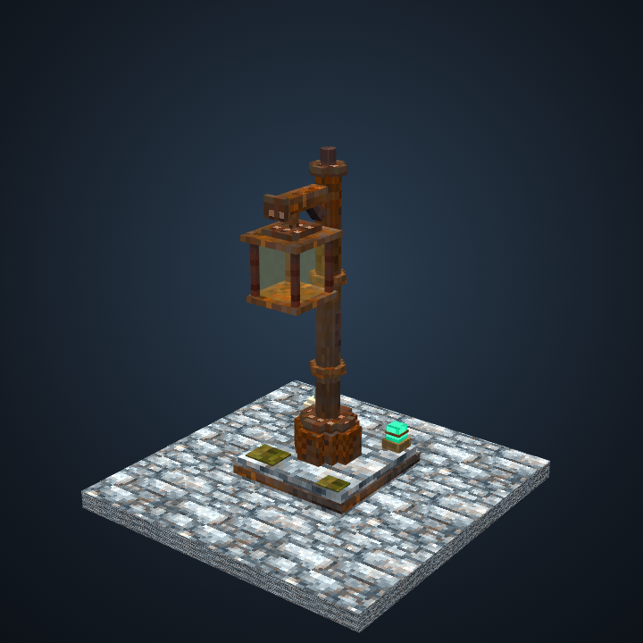 | **Iluminação Elétrica** | Poste de rua velho de ferro fundido, com 2 blocos de altura: pé de pedra, coluna redonda com anéis e uma lanterna pendurada no braço. Acende sozinho quando escurece e apaga quando amanhece, sem óleo nem vela. | 1 (só de noite) |
| 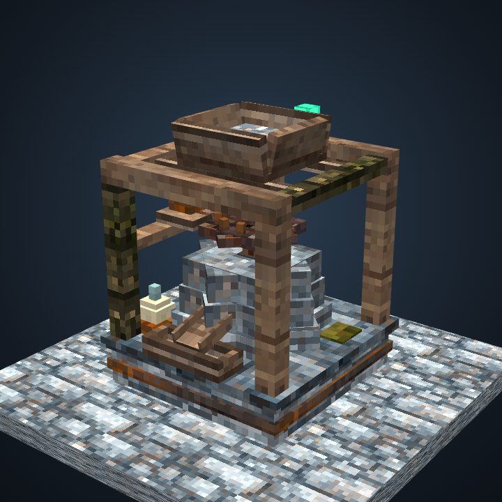 | **Moedor Elétrico** | Versão elétrica do Moleiro. Bota grão ou minério no funil: ele cai no olho da mó; o pinhão do motor engata nos pinos da roda de cima e gira a mó (igual moinho antigo). A farinha / minério moído sai pela bica pro caixote. | 3 |
| 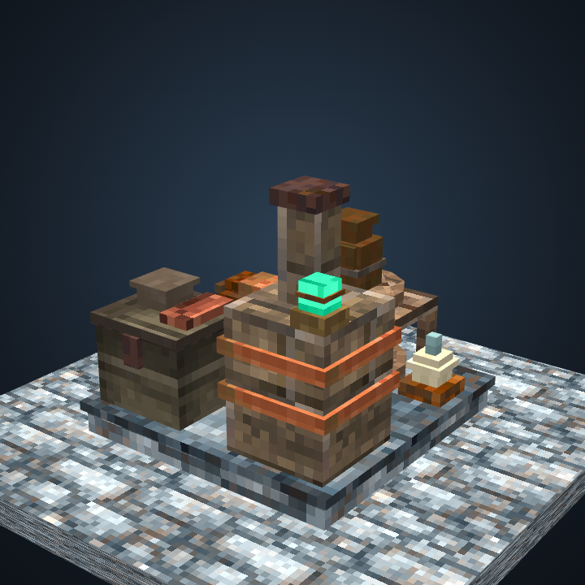 | **Olaria Elétrica** | Versão elétrica do Oleiro. Torno de oleiro de verdade: o motor encosta uma roda de atrito no volante embaixo da mesa e o vaso gira lá em cima. | 3 |
| 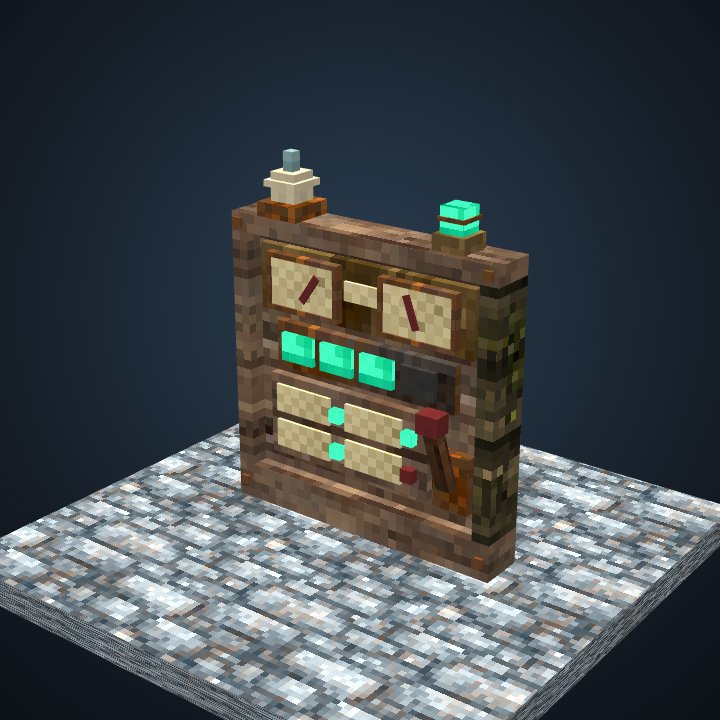 | **Painel da Rede** | Quadro de madeira e latão pra pendurar na parede: mostra a rede toda de um jeito fácil. | 1 |
| 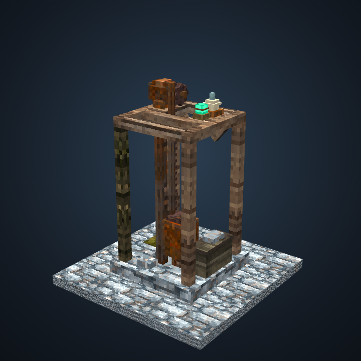 | **Pedreira Automática** | Bate-estaca de pedreira: o motor lá em cima gira o pinhão, que puxa a cremalheira presa no martelo; o martelo sobe correndo entre as 2 guias de ferro e cai com tudo no buraco. | 8 |
| 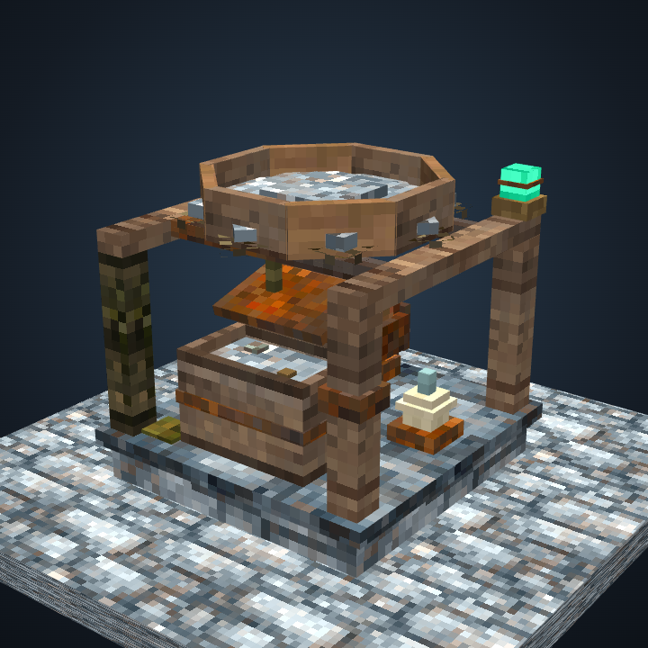 | **Peneira Elétrica** | Versão elétrica do Garimpeiro. | 3 |
| 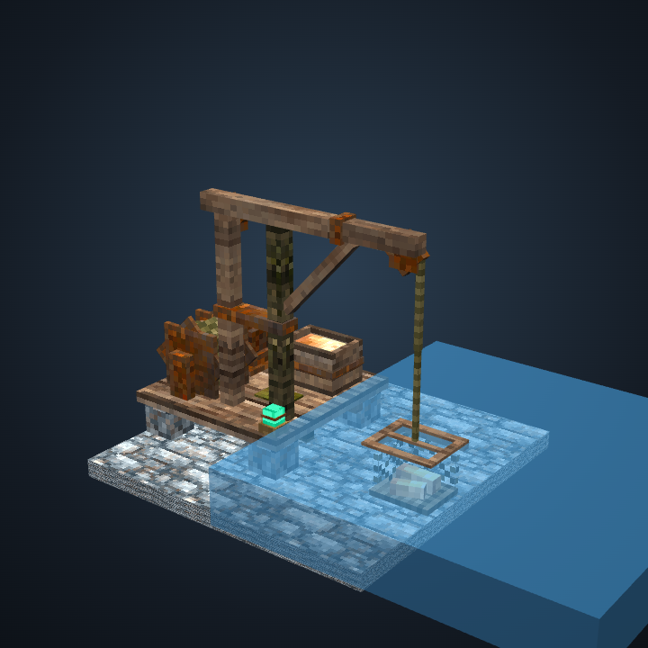 | **Pesca Elétrica** | Versão elétrica do Pescador. Fica na beira do rio ou lago com a lança por cima da água: o motor gira o tambor, que solta a corda e desce o cesto-rede; espera um pouco e enrola de volta, despejando os peixes no caixote do deque. | 1 |
| 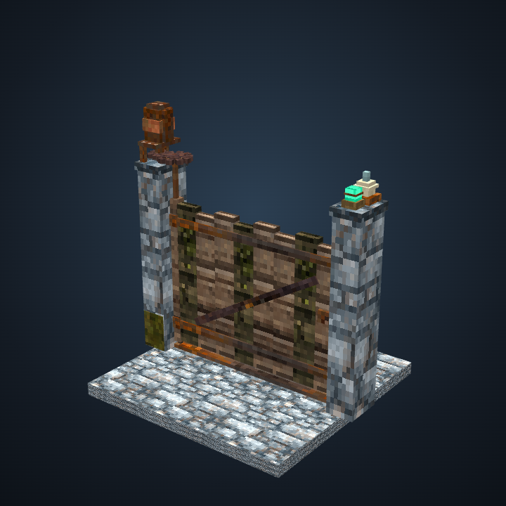 | **Portão Elétrico** | Portão de 2 blocos de largura que abre sozinho quando você (ou alguém da sua lista de amigos) chega perto e fecha depois que passou. À noite fica trancado, e nunca abre pra drifter nem bicho. | 2 (só quando mexe) |
| 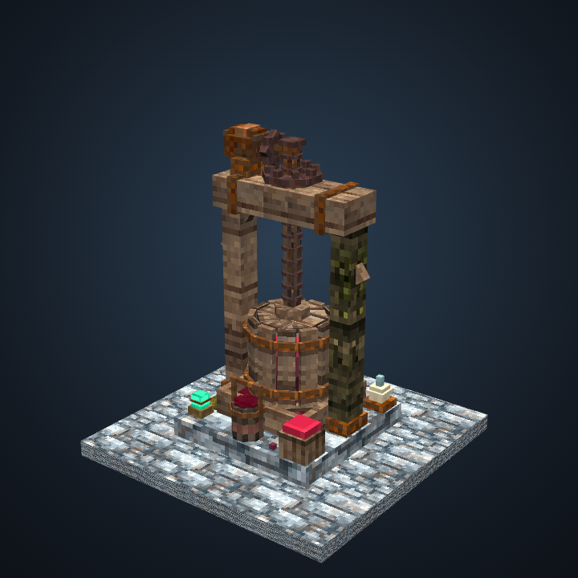 | **Prensa de Frutas** | Prensa de fuso de verdade: o cesto redondo de aduelas (com 2 aros de ferro) fica apoiado na bacia; o motor lá em cima gira a coroa (a porca do fuso) pelo pinhão, e o fuso desce sem girar, empurrando o disco redondo de prensar contra as frutas. | 1 |
| 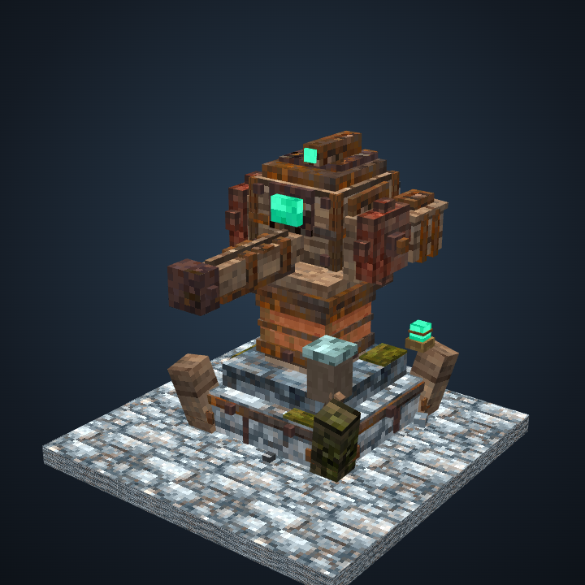 | **Sentinela Elétrica** | A Sentinela agora faz parte da Automação (um mod a menos): a mesma torre de ferro enferrujado que vigia girando e atira virotes em drifters, lobos, ursos, hienas e criaturas temporais — munição infinita, mas cada disparo gasta energia. | 1 vigiando · 3 atirando |
| 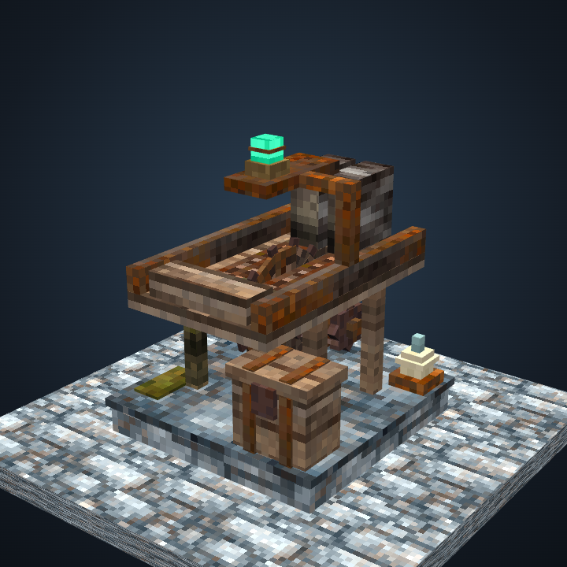 | **Serraria Elétrica** | Versão elétrica do Lenhador. A tora vai empurrada pela bancada contra a serra circular (o motor de baixo gira a serra pela correia) e sai cortada; 12 tábuas por tora caem no bauzinho (sem gastar serrote). | 8 |
| 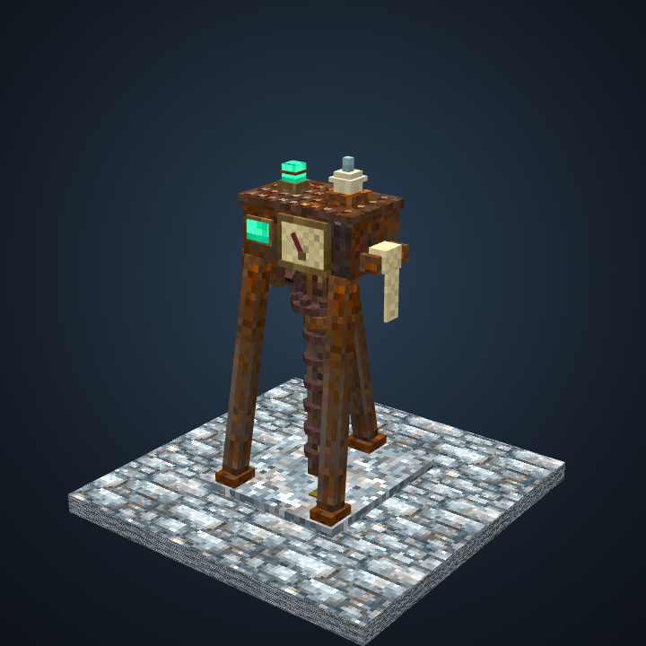 | **Sonda de Minério** | Tripé de ferro com uma broca fininha que gira entrando no chão — é a picareta de prospecção, só que sozinha e no chunk inteiro: o motor pendurado embaixo da caixa gira a coroa da broca pelo pinhão. | 3 |
| 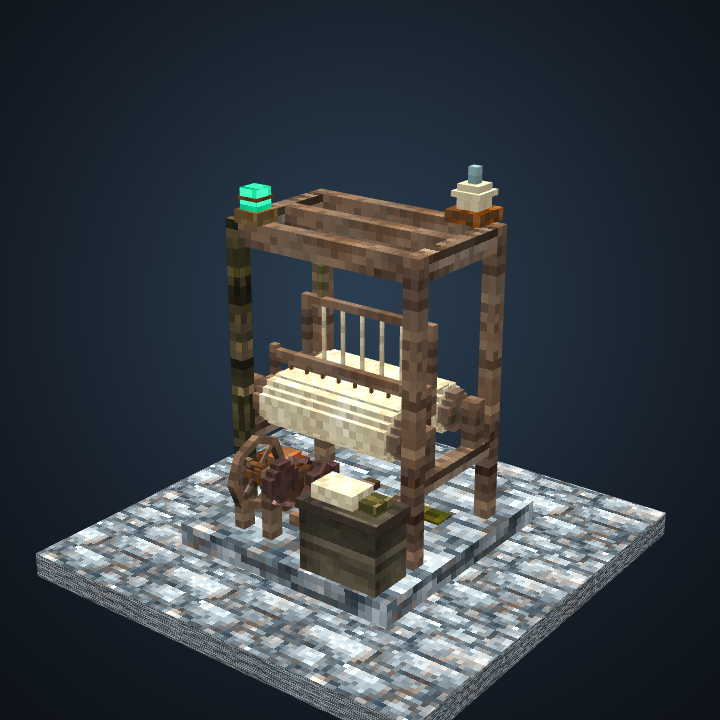 | **Tear Elétrico** | Linho vira pano sozinho: o motor puxa por correia a roda de fiar, que fia o linho, e o tear tece — o liço sobe e desce abrindo os fios, a lançadeira passa no meio e o pente bate a trama. | 1 |
| 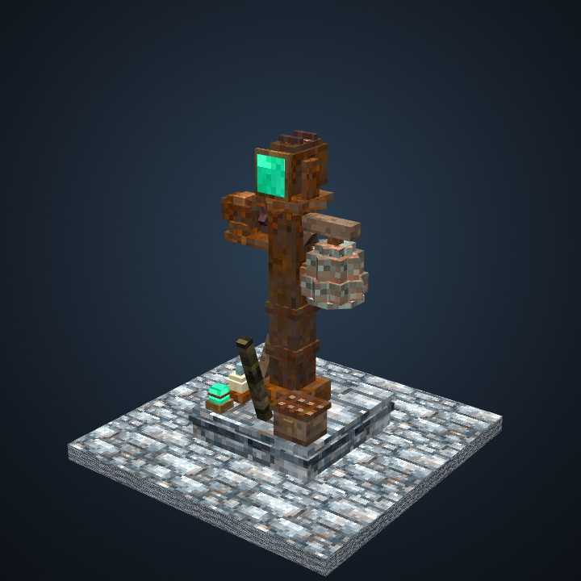 | **Vigia Elétrico** | Versão elétrica do Vigia: o pinhão do motor gira a engrenagem do holofote, que varre a área de noite. | 1 |

## 📖 O Manual

O **Manual da Automação** é um livro que você ganha automaticamente na primeira vez que entra num mundo com o mod — mundo novo ou já criado.
Perdeu? Faz outro na bancada com **2 papéis + 1 couro**. Clique direito com ele na mão pra abrir.

- **Comece aqui**: como a energia funciona, sua primeira rede, glossário e perguntas frequentes.
- **Fontes, Baterias e Máquinas**: um capítulo por peça, com a receita desenhada.
- **Guia dos 100 dias**: do dia 1 (sílex, gravetos, abrigo) até o ferro e a primeira automação — passando por cobre, bronze, preparar o inverno, o que é o inverno, tempestade temporal e estabilidade.
- **Enciclopédia**: agricultura, cozinha, conservas, animais, caça e pesca, mineração e prospecção, metalurgia, cerâmica, roupas e armaduras, construção, ferramentas, comércio, ruínas e saúde.

## Receitas

Receitas baratas, no espírito do jogo: o **Começo à mão** sai só com lenha, graveto, capim seco, sílex e pedra solta;
as máquinas usam tábuas, pedra, sílex, gravetos, corda e a **engrenagem enferrujada**; cobre e **vidro** nas peças elétricas.
Também estão no Manual, no capítulo de cada peça. As letras abaixo mostram a grade da bancada (`[ ]` = vazio).

<b>🪵 Começo à mão</b>

| Peça | Receita (bancada 3x3) | Ingredientes |
|---|---|---|
| Gerador de Manivela | <code>[L][U][L]</code> <code>[O][K][O]</code> <code>[L][U][L]</code> | **K** graveto · **L** lenha · **O** pedra solta (do chão) · **U** pepita de cobre |
| Peneira de Balanço | <code>[K][&nbsp;][K]</code> <code>[L][D][L]</code> <code>[K][&nbsp;][K]</code> | **D** capim seco · **K** graveto · **L** lenha |
| Torno de Vara | <code>[K][K][K]</code> <code>[L][F][L]</code> <code>[L][&nbsp;][L]</code> | **F** sílex · **K** graveto · **L** lenha |
| Pedestal do Raio | <code>[&nbsp;][F][&nbsp;]</code> <code>[F][L][F]</code> <code>[L][L][L]</code> | **F** sílex · **L** lenha |

<b>⚡ Fontes de energia</b>

| Peça | Receita (bancada 3x3) | Ingredientes |
|---|---|---|
| Cata-vento Gerador | <code>[R][P][R]</code> <code>[P][G][P]</code> <code>[K][I][K]</code> | **G** engrenagem enferrujada · **I** lingote de cobre · **K** graveto · **P** tábua · **R** corda (ou Engrenagem de Madeira no lugar da enferrujada) |
| Gerador a Lenha | <code>[S][I][S]</code> <code>[S][G][S]</code> <code>[S][F][S]</code> | **F** sílex · **G** engrenagem enferrujada · **I** lingote de cobre · **S** pedra (cascalho/cobblestone) (ou Engrenagem de Madeira no lugar da enferrujada) |
| Painel Solar | <code>[V][V][V]</code> <code>[I][G][I]</code> <code>[P][K][P]</code> | **G** engrenagem enferrujada · **I** lingote de cobre · **K** graveto · **P** tábua · **V** vidro (ou Engrenagem de Madeira no lugar da enferrujada) |
| Roda Geradora | <code>[P][G][P]</code> <code>[P][I][P]</code> <code>[S][S][S]</code> | **G** engrenagem enferrujada · **I** lingote de cobre · **P** tábua · **S** pedra (cascalho/cobblestone) (ou Engrenagem de Madeira no lugar da enferrujada) |
| Torre de Tempestade | <code>[&nbsp;][I][&nbsp;]</code> <code>[P][G][P]</code> <code>[S][V][S]</code> | **G** engrenagem enferrujada · **I** lingote de cobre · **P** tábua · **S** pedra (cascalho/cobblestone) · **V** vidro (ou Engrenagem de Madeira no lugar da enferrujada) |

<b>🔋 Baterias e postes</b>

| Peça | Receita (bancada 3x3) | Ingredientes |
|---|---|---|
| Bateria | <code>[C][I][C]</code> <code>[C][I][C]</code> <code>[P][P][P]</code> | **C** barro · **I** lingote de cobre · **P** tábua |
| Poste de Energia | <code>[&nbsp;][V][&nbsp;]</code> <code>[&nbsp;][I][&nbsp;]</code> <code>[&nbsp;][P][&nbsp;]</code> | **I** lingote de cobre · **P** tábua · **V** vidro |

<b>⚙️ Máquinas</b>

| Peça | Receita (bancada 3x3) | Ingredientes |
|---|---|---|
| Acendedor de Lampiões | <code>[P][G][P]</code> <code>[P][F][P]</code> <code>[S][I][S]</code> | **F** sílex · **G** engrenagem enferrujada · **I** lingote de cobre · **P** tábua · **S** pedra (cascalho/cobblestone) |
| Alambique | <code>[I][I][I]</code> <code>[P][G][P]</code> <code>[B][B][B]</code> | **B** tijolo queimado · **G** engrenagem enferrujada · **I** lingote de cobre · **P** tábua |
| Aquecedor | <code>[M][I][M]</code> <code>[M][G][M]</code> | **G** engrenagem enferrujada · **I** lingote de cobre · **M** chapa de ferro |
| Bancada Elétrica | <code>[P][G][P]</code> <code>[P][F][P]</code> <code>[S][I][S]</code> | **F** sílex · **G** engrenagem enferrujada · **I** lingote de cobre · **P** tábua · **S** pedra (cascalho/cobblestone) |
| Bomba d'Água e Irrigador | <code>[P][G][P]</code> <code>[P][F][P]</code> <code>[S][I][S]</code> | **F** sílex · **G** engrenagem enferrujada · **I** lingote de cobre · **P** tábua · **S** pedra (cascalho/cobblestone) |
| Calendário Elétrico | <code>[P][H][P]</code> <code>[V][G][V]</code> <code>[P][I][P]</code> | **G** engrenagem enferrujada · **H** papel · **I** lingote de cobre · **P** tábua · **V** vidro |
| Carvoeira Elétrica | <code>[P][G][P]</code> <code>[P][F][P]</code> <code>[S][I][S]</code> | **F** sílex · **G** engrenagem enferrujada · **I** lingote de cobre · **P** tábua · **S** pedra (cascalho/cobblestone) |
| Cerca Elétrica | <code>[K][I][K]</code> <code>[K][I][K]</code> | **I** lingote de cobre · **K** graveto |
| Chocadeira | <code>[P][G][P]</code> <code>[P][F][P]</code> <code>[S][I][S]</code> | **F** sílex · **G** engrenagem enferrujada · **I** lingote de cobre · **P** tábua · **S** pedra (cascalho/cobblestone) |
| Cocho Automático | <code>[P][G][P]</code> <code>[P][F][P]</code> <code>[S][I][S]</code> | **F** sílex · **G** engrenagem enferrujada · **I** lingote de cobre · **P** tábua · **S** pedra (cascalho/cobblestone) |
| Colheitadeira | <code>[P][G][P]</code> <code>[P][F][P]</code> <code>[S][I][S]</code> | **F** sílex · **G** engrenagem enferrujada · **I** lingote de cobre · **P** tábua · **S** pedra (cascalho/cobblestone) |
| Colmeia Elétrica | <code>[P][G][P]</code> <code>[P][F][P]</code> <code>[S][I][S]</code> | **F** sílex · **G** engrenagem enferrujada · **I** lingote de cobre · **P** tábua · **S** pedra (cascalho/cobblestone) |
| Curtume Automático | <code>[P][G][P]</code> <code>[P][F][P]</code> <code>[S][I][S]</code> | **F** sílex · **G** engrenagem enferrujada · **I** lingote de cobre · **P** tábua · **S** pedra (cascalho/cobblestone) |
| Defumador Elétrico | <code>[P][G][P]</code> <code>[P][F][P]</code> <code>[S][I][S]</code> | **F** sílex · **G** engrenagem enferrujada · **I** lingote de cobre · **P** tábua · **S** pedra (cascalho/cobblestone) |
| Elevador | <code>[P][R][P]</code> <code>[P][G][P]</code> <code>[P][I][P]</code> | **G** engrenagem enferrujada · **I** lingote de cobre · **P** tábua · **R** corda |
| Estabilizador Temporal | <code>[I][T][I]</code> <code>[V][G][V]</code> <code>[S][S][S]</code> | **G** engrenagem enferrujada · **I** lingote de cobre · **S** pedra (cascalho/cobblestone) · **T** engrenagem temporal · **V** vidro |
| Esteira Transportadora | <code>[P][G][P]</code> <code>[P][F][P]</code> <code>[S][I][S]</code> | **F** sílex · **G** engrenagem enferrujada · **I** lingote de cobre · **P** tábua · **S** pedra (cascalho/cobblestone) |
| Estufa de Cogumelos | <code>[P][G][P]</code> <code>[P][F][P]</code> <code>[S][I][S]</code> | **F** sílex · **G** engrenagem enferrujada · **I** lingote de cobre · **P** tábua · **S** pedra (cascalho/cobblestone) |
| Fogão Elétrico | <code>[P][G][P]</code> <code>[P][F][P]</code> <code>[S][I][S]</code> | **F** sílex · **G** engrenagem enferrujada · **I** lingote de cobre · **P** tábua · **S** pedra (cascalho/cobblestone) |
| Forja Automática | <code>[M][I][M]</code> <code>[S][G][S]</code> <code>[S][S][S]</code> | **G** engrenagem enferrujada · **I** lingote de cobre · **M** chapa de ferro · **S** pedra (cascalho/cobblestone) |
| Fornalha Elétrica | <code>[B][I][B]</code> <code>[B][G][B]</code> <code>[S][S][S]</code> | **B** tijolo queimado · **G** engrenagem enferrujada · **I** lingote de cobre · **S** pedra (cascalho/cobblestone) |
| Geladeira | <code>[P][M][P]</code> <code>[I][G][I]</code> <code>[P][M][P]</code> | **G** engrenagem enferrujada · **I** lingote de cobre · **M** chapa de ferro · **P** tábua |
| Iluminação Elétrica | <code>[&nbsp;][V][&nbsp;]</code> <code>[&nbsp;][I][&nbsp;]</code> <code>[&nbsp;][K][&nbsp;]</code> | **I** lingote de cobre · **K** graveto · **V** vidro |
| Moedor Elétrico | <code>[P][G][P]</code> <code>[P][F][P]</code> <code>[S][I][S]</code> | **F** sílex · **G** engrenagem enferrujada · **I** lingote de cobre · **P** tábua · **S** pedra (cascalho/cobblestone) |
| Olaria Elétrica | <code>[P][G][P]</code> <code>[P][F][P]</code> <code>[S][I][S]</code> | **F** sílex · **G** engrenagem enferrujada · **I** lingote de cobre · **P** tábua · **S** pedra (cascalho/cobblestone) |
| Painel da Rede | <code>[P][H][P]</code> <code>[I][G][I]</code> | **G** engrenagem enferrujada · **H** papel · **I** lingote de cobre · **P** tábua |
| Pedreira Automática | <code>[P][G][P]</code> <code>[P][F][P]</code> <code>[S][I][S]</code> | **F** sílex · **G** engrenagem enferrujada · **I** lingote de cobre · **P** tábua · **S** pedra (cascalho/cobblestone) |
| Peneira Elétrica | <code>[P][G][P]</code> <code>[P][F][P]</code> <code>[S][I][S]</code> | **F** sílex · **G** engrenagem enferrujada · **I** lingote de cobre · **P** tábua · **S** pedra (cascalho/cobblestone) |
| Pesca Elétrica | <code>[P][G][P]</code> <code>[P][F][P]</code> <code>[S][I][S]</code> | **F** sílex · **G** engrenagem enferrujada · **I** lingote de cobre · **P** tábua · **S** pedra (cascalho/cobblestone) |
| Portão Elétrico | <code>[P][I][P]</code> <code>[P][G][P]</code> | **G** engrenagem enferrujada · **I** lingote de cobre · **P** tábua |
| Prensa de Frutas | <code>[P][G][P]</code> <code>[P][F][P]</code> <code>[S][I][S]</code> | **F** sílex · **G** engrenagem enferrujada · **I** lingote de cobre · **P** tábua · **S** pedra (cascalho/cobblestone) |
| Sentinela Elétrica | <code>[R][P][R]</code> <code>[F][G][F]</code> <code>[K][I][K]</code> | **F** sílex · **G** engrenagem enferrujada · **I** lingote de cobre · **K** graveto · **P** tábua · **R** corda |
| Serraria Elétrica | <code>[P][G][P]</code> <code>[P][F][P]</code> <code>[S][I][S]</code> | **F** sílex · **G** engrenagem enferrujada · **I** lingote de cobre · **P** tábua · **S** pedra (cascalho/cobblestone) |
| Sonda de Minério | <code>[P][G][P]</code> <code>[P][F][P]</code> <code>[S][I][S]</code> | **F** sílex · **G** engrenagem enferrujada · **I** lingote de cobre · **P** tábua · **S** pedra (cascalho/cobblestone) |
| Tear Elétrico | <code>[P][G][P]</code> <code>[P][F][P]</code> <code>[S][I][S]</code> | **F** sílex · **G** engrenagem enferrujada · **I** lingote de cobre · **P** tábua · **S** pedra (cascalho/cobblestone) |
| Vigia Elétrico | <code>[P][G][P]</code> <code>[P][F][P]</code> <code>[S][I][S]</code> | **F** sílex · **G** engrenagem enferrujada · **I** lingote de cobre · **P** tábua · **S** pedra (cascalho/cobblestone) |

## Instalação

1. Baixe o `automacao.zip` na aba [Releases](../../releases).
2. Coloque em `%APPDATA%\VintagestoryData\Mods` (não precisa descompactar).
3. Precisa estar no servidor **e** no cliente. Vintage Story **1.22**.

> **Vindo da Sentinela?** A Sentinela agora faz parte da Automação (Sentinela Elétrica). Tire o mod `sentinela`: a Automação traz um remapeamento pras sentinelas antigas virarem a nova (se o jogo perguntar, aceite).
> **Vindo do Dumbwaiter?** O Elevador da Automação faz o mesmo (anda entre estações e manda baús). Tire os baús das estações antigas antes de remover o outro mod.

## Pra quem quer mexer

- `src/` — o mod em C# (.NET 10). O núcleo é `BEMaquina` (bauzinho, energia, janela), `RedeEnergia` (rede sem fio), `MaquinaRenderer` (anima as partes) e `src/Trabalhos/` (o que cada máquina faz).
- `modelos/` — os modelos 3D são **gerados por código** (`auto_*.py`, com o kit de peças em `gen_modelos.py`). `checa_flutuando.py` e `checa_sobreposto.py` garantem que nenhuma peça flutua nem se sobrepõe.
- `gen_mod.py` — transforma os modelos em assets do jogo (shapes, blocktypes, lang, receitas, Manual).
- Compilar: `py -I gen_mod.py` e depois `dotnet build -c Release` (já empacota e instala o zip).

---

Mod de **@mtnunes** · feito com carinho (e muita ferrugem) pra comunidade de Vintage Story

